# Build a chess engine in Python

We are building a simple chess engine in Python and uploading it to
[machineplay.org](https://machineplay.org).

Not from scratch though. We use an existing library,
[python-chess](https://python-chess.readthedocs.io/en/latest/), that already knows the rules:
board, pieces, legal moves, checkmate. And machineplay.org is our UI: chessboard, games,
tournaments, and a library of other engines to play against.

What is left is the interesting part: the searcher, the thing that actually picks a move.


> [!TODO]
> Link a game played by the finished engine, so readers see where this ends up.

## The ladder

Every chapter is a new engine, and from depth 1 on each one is stronger than the one before it, or
does the same job for less. The last rung is different: it adds an idea nobody vouched for, and
teaches you how to find out whether it helped. Upload them all and make them play each other.

1. **first legal move**: what you get right after forking
2. **random mover**: sets up the edit / upload / play loop
3. **depth 1**: counts material, grabs any piece it can reach
4. **minimax**: checks what the opponent does back
5. **negamax**: same engine, half the code
6. **alpha-beta**: same move, a fraction of the work
7. **iterative deepening**: thinks on a clock instead of a fixed depth
8. **quiescence**: stops evaluating in the middle of a fight
9. **piece-square tables**: learns where pieces belong
10. **did it help?**: one more idea, and the measurement it has to survive

First upload takes about 10 minutes. The whole ladder is a weekend, and by the end of it your
engine might play chess better than you.

## How chapters work

Every chapter gives you the idea, the chess API you need for it, and then a task. The solution is
right there under it, folded away, plus a full working engine in the starter's
[`solutions/`](https://github.com/MachinePlay/python-chess-starter/tree/main/solutions) folder. Unfold it
whenever you want, but try first: each of these is one good idea, and people originally found them
by staring at the same problem you will be staring at.

## Prerequisites

- Basic Python programming skills (ifs, loops, recursion)
- General programmer tools: a text editor, git, a GitHub account, Docker installed
- Knowing what chess is

You do not need to be good at chess, and you do not need any AI/ML background, C++, or to have
written an engine before.

Docker and the machineplay account are how your engine gets online, where it can play other
people's engines and stream its games. That is the path this tutorial
takes. If you cannot use docker where you are, the engine is still an ordinary program speaking an
open protocol, and the appendix lists the local ways to run it.


# Fork and upload

Before writing any chess code, get the loop working end to end: fork it, upload it, watch
it play.

1. Fork the starter code to your github account:
   https://github.com/MachinePlay/python-chess-starter/fork

2. Clone your fork:

   ```
   git clone <your-link>
   cd <your-engine>
   ```

3. Install [uv](https://docs.astral.sh/uv/getting-started/installation/), then the machineplay CLI:

   ```
   uv tool install machineplay
   ```

   Needs Python 3.12+ and a running Docker daemon, because upload builds an image on your machine.
   (No docker available? The appendix has the local-only route.)

4. Register on [machineplay.org](https://machineplay.org)

5. Log in from the CLI:

   ```
   machineplay login
   ```

   It sends you to machineplay.org/cli, you copy the token from there and paste it back.

6. Build and upload:

   ```
   machineplay upload
   ```

   It builds the Dockerfile in the current directory, checks the image really speaks UCI, and
   pushes it.

   `upload` asks for an engine **name** and a **version**. The name defaults to your folder name,
   keep it the same for the whole tutorial: the name is your engine, versions are the chapters.
   Name this version `first-legal-move`, later ones `random`, `depth1`, `minimax` and so on.
   Your engine now lives at `machineplay.org/<you>/<engine>`, and a single version of it is
   `<your-engine>:first-legal-move`.

7. Make it play itself. On the [machineplay.org](https://machineplay.org) front page, pick
   `<your-engine>:first-legal-move` for both white and black and start the game.

   > [!TODO]
   > The CLI cannot start games yet. Planned:
   > `machineplay game --white <your-engine>:first-legal-move --black <your-engine>:first-legal-move`

Watch that game. It is bad: knight to the rim, same move every time from the same position, pieces
given away for free. Everything in this tutorial is measured against it.

# Understanding the starter code

Your fork has a handful of files, and most of them need no explanation: `README.md`, `LICENSE`, and
`pyproject.toml` with `uv.lock`, which pin the one dependency. Two of them matter.

`Dockerfile` packages the engine. It installs Python 3.13 and the dependencies, copies `main.py`
in, and makes running the image the same thing as running the engine. That is all machineplay
asks for, which also means Python is optional: anything you can build in a Dockerfile and that
speaks UCI is welcome. C++, Rust, Go, JavaScript, Haskell, assembly if you are feeling brave.

`main.py` is the engine itself, and the rest of this chapter.

Before reading any of it, talk to it:

```bash
uv run python main.py
```

Type `uci`, `isready`, `go`, `quit`. That is asking its name, asking whether it is ready, asking
for its best move in the starting position, and saying bye:

```
$ uv run python main.py
uci
id name python-chess-starter
id author your-name-here
uciok
isready
readyok
go
bestmove g1h3
quit
```

You just played the GUI's part of the conversation. Now the same thing from the engine's side.

## The UCI loop

```python
import sys
import chess

def uci() -> None:
    board = chess.Board()

    while True:
        line = sys.stdin.readline()
        if not line:  # stdin closed
            break
        command = line.strip()

        if command == "uci":
            print("id name python-chess-starter")
            print("id author your-name-here")
            print("uciok")
        elif command == "isready":
            print("readyok")
        elif command == "ucinewgame":
            board.reset()
        elif command.startswith("position"):
            board = parse_position(command)
        elif command.startswith("go"):
            move = choose_move(board)
            print(f"bestmove {move.uci()}")
        elif command == "quit":
            break

        sys.stdout.flush()
```

A chess engine is an interpreter. It runs a read-eval-print loop, like the `python` prompt does:
read a command, do it, print the answer, wait for the next one. Engine and GUI talk over stdin and
stdout, the same two streams `input()` and `print()` use, spelled out by hand for two reasons:

- `sys.stdin.readline()` instead of `input()`: when the other side closes the pipe it returns an
  empty string instead of raising, so the loop notices the GUI is gone and exits
- `sys.stdout.flush()` after every reply: Python buffers stdout when it is a pipe rather than a
  terminal, and an unflushed `bestmove` sits in that buffer while the GUI waits for it forever

The only state that survives from one command to the next is `board`, a `chess.Board` from
[python-chess](https://python-chess.readthedocs.io/en/latest/): the 64 squares and what stands on
them, whose turn it is, castling rights, and the moves played so far. You will meet its methods as
the chapters need them. As a preview: `board.legal_moves` lists the legal moves, `board.push(move)`
and `board.pop()` play a move and take it back, and `board.is_checkmate()` does what it says.

> [!NOTE]
> Using python-chess might feel like cheating. It is a shortcut that keeps this tutorial about
> search instead of move generation, and you can always replace it later: the board is the low
> level foundation of every engine, and python-chess builds it from **bitboards**, one 64-bit
> integer per piece type. They are not the only way to do it, see
> [Board Representation](https://chessprogramming.org/Board_Representation) on the Chess
> Programming Wiki.

The commands:

- `uci`: the engine introduces itself to whoever is driving it: you, machineplay, or any other
  program that speaks UCI. Rename the engine and put your own name in `id author`
- `isready`: a health check. The GUI asks `isready`, the engine answers `readyok`; ping and pong
- `ucinewgame`: a new game is starting, forget the old one
- `position`: here is the current position, including the move your opponent just made
- `go`: think, and answer with `bestmove`
- `quit`: exit

Five of them are done and stay that way. `go` is the one you spend the rest of this tutorial on.

## Parsing `position`

The GUI never tells you "your opponent played e5". It sends the whole game every time, as a
starting point plus every move since: `position startpos moves e2e4 e7e5`. `startpos` is this, the
position every game begins from:

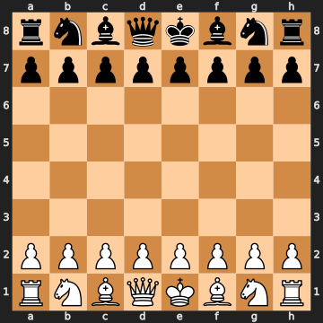

`parse_position` splits the command on spaces, starts from a fresh `chess.Board()`, and replays the
moves onto it with `board.push_uci`. UCI is also the name of the move format: `e2e4` means the
piece on e2 goes to e4, and a promotion adds the new piece, `e7e8q`.

```python
def parse_position(command: str) -> chess.Board:
    """Build a board from a UCI ``position`` command.

    Handles the two forms the protocol allows:

        position startpos
        position startpos moves e2e4 e7e5
    """
    tokens = command.split()

    if tokens[1] == "startpos":
        board = chess.Board()
        moves_index = 2
    else:
        raise ValueError("Only `startpos` implemented")

    if len(tokens) > moves_index and tokens[moves_index] == "moves":
        for uci in tokens[moves_index + 1 :]:
            board.push_uci(uci)

    return board
```

The `ValueError` branch is the protocol's other form, `position fen ...`, which starts from an
arbitrary position. machineplay sends its openings as `startpos` plus moves, so nothing will send
you a `fen` until the last chapter, which is where you fix it.

## Choosing a move

The function that does the thinking is `choose_move`, and it is where all of your code will go:

```python
def choose_move(board: chess.Board) -> chess.Move:
    for move in board.legal_moves:
        return move  # Just return first move

    raise ValueError("Only called on boards with at least one legal move")
```

It returns the first legal move it finds. The starting position has twenty:

```python
>>> [move.uci() for move in chess.Board().legal_moves]
['g1h3', 'g1f3', 'b1c3', 'b1a3', 'h2h3', 'g2g3', 'f2f3', 'e2e3', 'd2d3', 'c2c3', 'b2b3', 'a2a3', 'h2h4', 'g2g4', 'f2f4', 'e2e4', 'd2d4', 'c2c4', 'b2b4', 'a2a4']
```

so from the starting position the engine plays `g1h3`, every single time.

# Random Mover

Ask the engine `go` a few times, locally or in a new game on machineplay. Same answer every time,
`g1h3` forever, because "first legal move" is a function of the position and nothing else.

Make it pick a random legal move instead. This buys you no strength at all, two engines with no
idea what they are doing are equally bad. What it buys you is the loop you will run for every
remaining chapter:

1. edit `choose_move` in `main.py`
2. talk to it locally: `uv run python main.py`, then `go` a couple of times
3. `machineplay upload`, same engine name, version `random`
4. start a game on machineplay and watch it

Chess API you need:

- `board.legal_moves`, the legal moves in this position (it is a generator, `list()` it)

<details>
<summary>Solution (try it yourself first)</summary>

The pieces that change in `main.py`:

```python
import random

def choose_move(board: chess.Board) -> chess.Move:
    moves = list(board.legal_moves)
    return random.choice(moves)
```

Full solution: [`solutions/random_mover.py`](https://github.com/MachinePlay/python-chess-starter/blob/main/solutions/random_mover.py)

</details>

The game you get is long and pointless: both sides throw pieces away, it drags past move 200, and
it usually ends in a draw with two lonely kings. Run it again and it plays something completely
different.

That last part matters more than it looks. From here on, one game tells you almost nothing about
whether your change helped. The engines that actually think start in the next chapter.

# Depth 1

Now make the engine think one move deep: try every legal move, look at the position each one leads
to, keep the best. Which needs a definition of "best", and the simplest one is material, the pieces
you still have on the board.

Piece type cost

```
King = 0
Queen = 9
Rook = 5
Bishop = 3
Knight = 3
Pawn = 1
```

King is 0, not infinity. Every legal position has exactly one king per side, so whatever number you
pick for it cancels out. Losing your king is not something to score, it is the game being over, and
we detect that separately in the next chapter.

So to find "best" you need a helper function `evaluate` that, for a given position, returns the
material difference. For example:

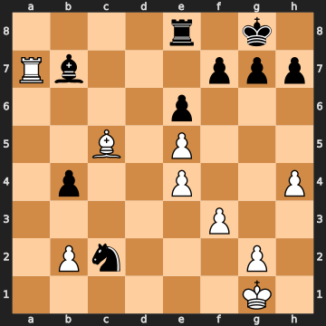

And the same position with every piece replaced by what it is worth:

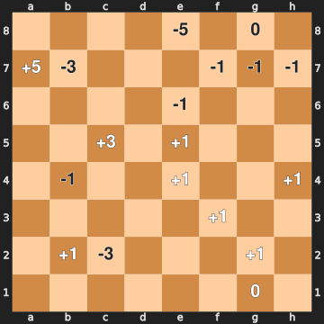

White has 14, black has 16. The score is white minus black, so `evaluate` returns -2 here: black is
up a knight for a pawn. Note that the number is always from white's point of view, positive means
white is better and negative means black is better, no matter whose turn it is.

In most cases the player with the better score is winning, so we want the move that pushes the
score our way.

Thinking one move deep means: try every legal move, score the position it leads to, keep the best
one. `eval = n` on a leaf is what your `evaluate` function returned for that position, and
`score = n` on a node is what the search decided. That vocabulary holds for the rest of the
tutorial.

<game-tree tree='{"kind":"max","children":[{"value":1},{"value":3},{"value":2}]}'>
  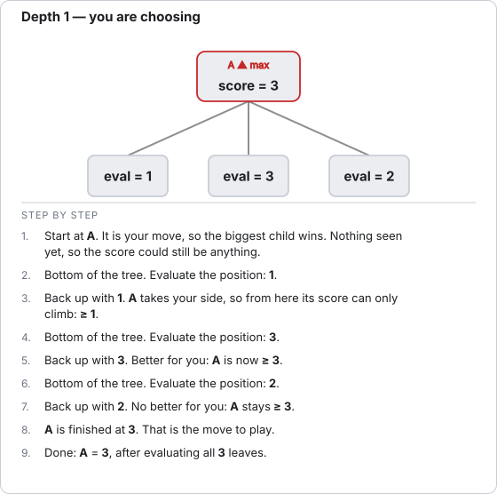
</game-tree>

Your engine has to play both colours, though. When it is black to move the score still comes from
white's point of view, so black is after the smallest number instead of the biggest. Same search,
one comparison flipped.

<game-tree tree='{"kind":"min","children":[{"value":3},{"value":1},{"value":2}]}'>
  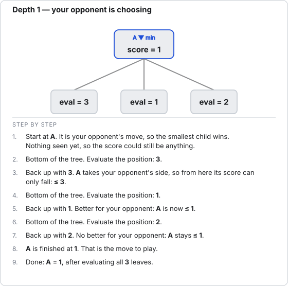
</game-tree>

Task:

Write an `evaluate(board)` that returns the material score of a position from white's point of
view. Then in `choose_move`, try every legal move and keep the best one: highest score when white
is to move, lowest when black is to move.

Write those two cases as two plain branches on `board.turn`, near enough copy paste. It is not the
shortest way to write it, and there is a trick that removes the duplication, but the two branches
are easier to follow while the search grows in the next chapters. We collapse them later.

Chess APIs you will need:
- `board.turn`, True if white to move, else False
- `chess.SQUARES`, contains index of 64 squares
- `board.piece_at(square)`, gives piece or None at asked square, piece has `piece.color`
  (`chess.WHITE` or `chess.BLACK`) and `piece.piece_type`, one of (`chess.KING`, `chess.QUEEN`,
  `chess.ROOK`, `chess.BISHOP`, `chess.KNIGHT`, `chess.PAWN`)
- `board.legal_moves` used with `board.push` and `board.pop`

<details>
<summary>Solution (try it yourself first)</summary>

The pieces that change in `main.py`:

```python
PIECE_TYPE_COST = {
    chess.KING: 0,
    chess.QUEEN: 9,
    chess.ROOK: 5,
    chess.BISHOP: 3,
    chess.KNIGHT: 3,
    chess.PAWN: 1,
}


def choose_move(board: chess.Board) -> chess.Move:
    best_move = None

    if board.turn == chess.WHITE:
        best_score = -math.inf
        for move in board.legal_moves:
            board.push(move)
            score = evaluate(board)
            board.pop()

            if score > best_score:
                best_score = score
                best_move = move
    else:
        best_score = math.inf
        for move in board.legal_moves:
            board.push(move)
            score = evaluate(board)
            board.pop()

            if score < best_score:
                best_score = score
                best_move = move

    if best_move is None:
        raise ValueError("choose_move is called on board without legal moves")

    return best_move


def evaluate(board: chess.Board) -> int:
    white_score = 0
    black_score = 0

    for square in chess.SQUARES:
        if piece := board.piece_at(square):
            if piece.color == chess.WHITE:
                white_score += PIECE_TYPE_COST[piece.piece_type]
            else:
                black_score += PIECE_TYPE_COST[piece.piece_type]

    return white_score - black_score
```

Full solution: [`solutions/depth1.py`](https://github.com/MachinePlay/python-chess-starter/blob/main/solutions/depth1.py)

</details>

Upload it as version `depth1` and put it against `random`.

The games still look a lot like the first-legal-move ones, because at depth 1 most moves score
exactly the same and the engine just takes the first of them. The one real difference: it grabs
anything it can reach. It will happily take a pawn with the queen, and it does not care at all that
the queen is gone on the next move, because it never looks at the next move. Watch a knight take a
pawn, then take a bishop, then get picked up by a rook.

## UCI: report centipawn score

Your engine is a black box: it says `bestmove f3e5` and you have no way to tell whether it meant it
or got there by accident. UCI has a channel for that. Any line starting with `info` is the engine
thinking out loud while it searches, and GUIs show it.

The field for the evaluation is `score cp N`, where cp is **centipawns**, hundredths of a pawn.
Engines count in centipawns because a whole pawn is a coarse unit: it leaves room to say "a third
of a pawn better" later, when your evaluation knows about more than material, without floats. So
change your table:

```
King = 0
Queen = 900
Rook = 500
Bishop = 300
Knight = 300
Pawn = 100
```

The position from earlier now evaluates to -200 instead of -2. Same thing, finer units.

One catch: `score cp` is from the point of view of the side to move, and your `evaluate` always
speaks white. When black is to move you have to flip the sign.

Task: report the score of the move you picked, and the move itself as `pv` (principal variation,
the line the engine expects; you have exactly one move of it so far).

<details>
<summary>Solution (try it yourself first)</summary>

Multiply every entry of `PIECE_TYPE_COST` by 100, then print one line before returning:

```python
    side = 1 if board.turn == chess.WHITE else -1
    print(f"info score cp {side * best_score} pv {best_move.uci()}")
```

</details>

Now it explains itself:

```
position startpos moves e2e4 e7e5 g1f3 b8c6
go
info score cp 100 pv f3e5
bestmove f3e5
```

A pawn up after `f3e5`, which is exactly what it just took, and exactly as far as it can see.

For anything UCI has no field for, `info string <whatever>` is free text that GUIs pass through
untouched. Dumping the score of every candidate move is a good use of it while you are debugging.

# Minimax

Depth 1 gives pieces away because it stops looking exactly one move too early. It sees the pawn it
wins and never sees the queen it loses for it.

So look further. Try your move, then let the opponent answer it, then answer that, and keep going
until you run out of patience. The rule at every level is the one you already wrote: white takes
the biggest number, black takes the smallest. White is the **maximizing** player, black is the
**minimizing** player, and that is the name: minimax.

Here is that running on a made up tree, four leaves, one move for you (`A`, **max**) and one reply
from your opponent (`B` and `C`, **min**). Small enough to follow every single step: it walks down
to a leaf, evaluates it, and each node keeps the best child it has seen so far, biggest on your
levels and smallest on your opponent's.

<game-tree mode="minimax">
  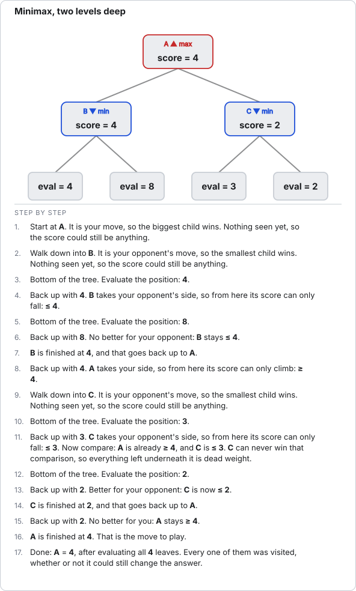
</game-tree>

That is minimax: depth 1 from the last chapter, except each move is scored by another search
instead of by `evaluate` directly, and the two colours take turns being the one who chooses.

## How deep

As deep as you can afford, and you cannot afford much. The number of legal moves in a position is
called the **branching factor**, and in chess it is around 30. Every extra level of search
multiplies the work by that:

```
depth 1 = 30
depth 2 = 30 * 30 = 900
depth 3 = 30 * 30 * 30 = 27 000
depth 4 = 30 ^ 4 = 810 000
depth 5 = 30 ^ 5 = 24 300 000
```

Python gets through something like twenty thousand positions a second, so depth 3 is about a
second, depth 4 is most of a minute, and depth 5 you can start and go make tea.

Depth 3 it is. Slow but playable, and the next three chapters of this tutorial are all about buying
more depth for the same time.

## The game can end inside the search

`evaluate` only counts material, and checkmate has no material signature: the king is still on the
board, worth 0, next to a completely equal pile of pieces. If you do not handle it, your engine
walks into mate and cannot see mates it could deliver.

python-chess will just tell you. `board.outcome()` is `None` while the game is still on, and
otherwise it hands you the result: `.winner` is `chess.WHITE`, `chess.BLACK`, or `None` for a draw,
and it already covers stalemate, dead positions and repetition, not only mate.

A win needs a number bigger than any material advantage could ever be, say 100000, positive for
white and negative for black. A draw is 0.

That scoring makes your engine indifferent between mating now and mating in three, so it can
shuffle around in a won position instead of finishing you off. Real engines subtract the current
depth from the mate score to prefer the quick one. We are skipping that.

Task:

`choose_move` stays what it is: the entry point that tries every legal move and returns the best
one. What changes is what it asks about each move. Instead of `evaluate(board)` it calls a new
function `minimax(board, depth)`, which returns the **score** of a position searched `depth` moves
deeper. So `choose_move` returns a move, `minimax` returns a number, and `minimax` calls itself.

Two things stop the recursion: the game being over, and `depth == 0`, where you fall back to
`evaluate(board)` like before.

Chess APIs you will need:
- `board.outcome()`, `None` while the game is still on, otherwise an object whose `.winner` is
  `chess.WHITE`, `chess.BLACK` or `None` for a draw

<details>
<summary>Solution (try it yourself first)</summary>

The pieces that change in `main.py`:

```python
DEPTH = 3

# A win is worth more than any material advantage you could ever have.
MATE_SCORE = 100_000


def choose_move(board: chess.Board) -> chess.Move:
    best_move = None

    if board.turn == chess.WHITE:
        best_score = -math.inf
        for move in board.legal_moves:
            board.push(move)
            score = minimax(board, DEPTH - 1)
            board.pop()

            if score > best_score:
                best_score = score
                best_move = move
    else:
        best_score = math.inf
        for move in board.legal_moves:
            board.push(move)
            score = minimax(board, DEPTH - 1)
            board.pop()

            if score < best_score:
                best_score = score
                best_move = move

    if best_move is None:
        raise ValueError("choose_move is called on board without legal moves")

    return best_move


def minimax(board: chess.Board, depth: int) -> float:
    """Score `board` from white's point of view, looking `depth` moves ahead."""
    # The game can end in the middle of the search, and `evaluate` would not
    # notice: a checkmate looks like an ordinary pile of pieces to it.
    outcome = board.outcome()
    if outcome is not None:
        if outcome.winner is None:
            return 0  # stalemate, dead position, repetition
        return MATE_SCORE if outcome.winner == chess.WHITE else -MATE_SCORE

    if depth == 0:
        return evaluate(board)

    if board.turn == chess.WHITE:
        best = -math.inf
        for move in board.legal_moves:
            board.push(move)
            best = max(best, minimax(board, depth - 1))
            board.pop()
    else:
        best = math.inf
        for move in board.legal_moves:
            board.push(move)
            best = min(best, minimax(board, depth - 1))
            board.pop()

    return best
```

Full solution: [`solutions/minimax.py`](https://github.com/MachinePlay/python-chess-starter/blob/main/solutions/minimax.py)

</details>

Upload it as `minimax` and put it against `depth1`. This is the first rung of the ladder that wins
properly: it takes back, it does not hang pieces to a one move threat, and it will find a mate in
two if you leave one lying around.

It also has a new problem. Depth 3 ends on *your* move, so the last thing the search sees is you
grabbing something, and the recapture is one move past the horizon. The engine is a permanent
optimist about its own last move. Depth 4 would fix that particular flavour of wrong, and depth 4
is 30 times more work than you can afford right now. And depth 4 only moves the horizon, it does
not remove it: whatever depth you pick, some exchange ends one move past it. The real fix is
cheaper than a whole extra depth, and it gets its own chapter once the search is fast enough to
afford it.

## UCI: report nodes

Right now you have no idea how much work a move costs. Time to measure it, because the next two
chapters are entirely about making this number smaller.

Task: count every position the search touches and report it, along with the depth and the score, on
the `info` line.

Two more standard fields go on the `info` line you already print: `depth` is how far you searched
and `nodes` is how many positions you looked at.

<details>
<summary>Solution (try it yourself first)</summary>

A module level counter, bumped once per visited position:

```python
NODES = 0  # how many positions the last search looked at


def minimax(board: chess.Board, depth: int) -> float:
    global NODES
    NODES += 1
    ...
```

Reset it at the top of `choose_move`, and report just before returning the move:

```python
    side = 1 if board.turn == chess.WHITE else -1
    print(f"info depth {DEPTH} nodes {NODES} score cp {int(side * best_score)} pv {best_move.uci()}")
```

</details>

```
position startpos moves e2e4 e7e5 g1f3 b8c6
go
info depth 3 nodes 24941 score cp 100 pv h1g1
bestmove h1g1
```

Twenty five thousand positions, about a second of thinking, three moves of foresight. Most of that
work turns out to be unnecessary: the next two chapters cut the number down hard without changing a
single move the engine plays.

# Negamax

Count the branches you have written. `choose_move` has a pair, `minimax` has another, and they are
the same code twice with `>` swapped for `<`, `max` for `min`, `-inf` for `+inf`. Alpha-beta in the
next chapter would turn two pairs into four. Every one of them is somewhere to typo a comparison
and end up with an engine that plays fine as white and throws pieces away as black.

They collapse into one, and the trick is this:

```
max(a, b) = -min(-a, -b)
```

Picking the smallest of some numbers is the same as picking the biggest of their negatives and
flipping the sign back. So stop scoring positions from white's point of view, and score them from
the point of view of **whoever is to move**. Then both players are maximizing, and there is one
branch instead of two.

Two things change:

- the leaf score becomes relative: `evaluate_relative(board)` is your `evaluate`, negated when it
  is black to move. `+200` now means "I am two pawns up", whoever I am
- a child comes back scored from the opponent's point of view, so it gets negated on the way up:
  `score = -negamax(board, depth - 1)`

Here is the tree from the last chapter read that way. The nodes are all one colour now, because
there is only one kind of node left, and every edge flips a sign:

<game-tree mode="negamax">
  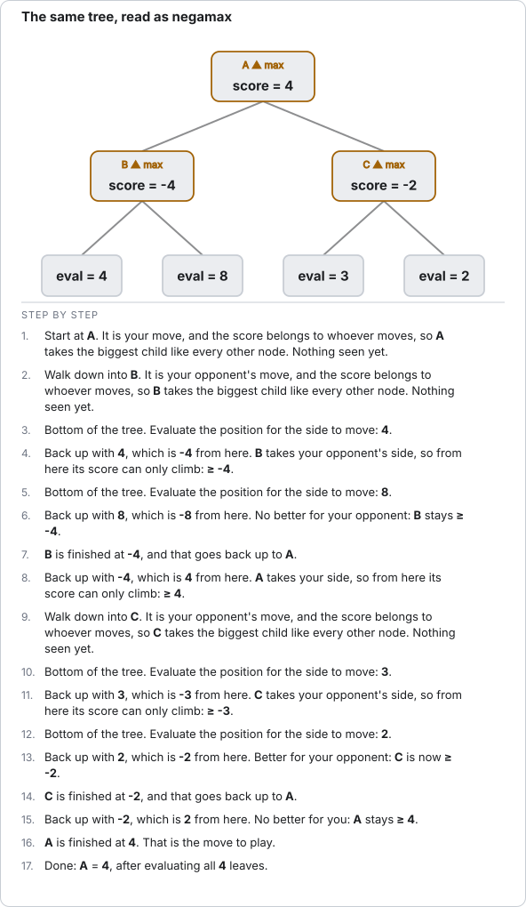
</game-tree>

The root still says 4 and still plays the same move. `B` reads -4 where minimax had it at 4: same
position, read from the other side of the board.

Checkmate gets simpler too. If the game is over and somebody won, the side to move is the one who
just got mated, because you cannot be checkmated on your own move. So it is `-MATE_SCORE`, and
there is no colour to ask about.

Task:

Replace `minimax` with a single-branch `negamax(board, depth)` that returns the score from the
point of view of the side to move, and add the `evaluate_relative` it needs. `choose_move` loses
its two branches as well: whatever the colour, it keeps the biggest `-negamax(...)`.

No new chess API this time, this chapter is only about the code you already have.

<details>
<summary>Solution (try it yourself first)</summary>

```python
def choose_move(board: chess.Board) -> chess.Move:
    best_move = None
    best_score = -math.inf

    for move in board.legal_moves:
        board.push(move)
        # After the push it is the opponent's turn, so their score is our score
        # with the sign flipped.
        score = -negamax(board, DEPTH - 1)
        board.pop()

        if score > best_score:
            best_score = score
            best_move = move

    if best_move is None:
        raise ValueError("choose_move is called on board without legal moves")

    return best_move


def negamax(board: chess.Board, depth: int) -> float:
    """Score `board` from the point of view of the side to move."""
    outcome = board.outcome()
    if outcome is not None:
        # A winner means the side to move has just been mated, and we are
        # scoring for the side to move, so there is no colour to ask about.
        return 0 if outcome.winner is None else -MATE_SCORE

    if depth == 0:
        return evaluate_relative(board)

    best = -math.inf
    for move in board.legal_moves:
        board.push(move)
        best = max(best, -negamax(board, depth - 1))
        board.pop()

    return best


def evaluate_relative(board: chess.Board) -> int:
    """The same material score, from the point of view of whoever is to move."""
    return evaluate(board) if board.turn == chess.WHITE else -evaluate(board)
```

Full solution: [`solutions/negamax.py`](https://github.com/MachinePlay/python-chess-starter/blob/main/solutions/negamax.py)

</details>

The `info` line gets simpler as well: `best_score` is already from the mover's point of view, which
is exactly what UCI wanted, so the sign flip you wrote in the Depth 1 chapter goes away.

There is nothing to play here. Negamax is the same engine: same moves, same games, same node count
down to the digit.

```
minimax   info depth 3 nodes 24941 score cp 100 pv h1g1
negamax   info depth 3 nodes 24941 score cp 100 pv h1g1
```

That is the point. You now have one search function instead of two halves that have to agree, and
the next chapter adds a genuinely fiddly idea on top of it. Doing that twice, once per colour,
is how people lose an evening.

# Alphabeta

Here is a claim that should sound wrong: you can skip large parts of the tree, never look at those
positions at all, and still come out with exactly the move minimax would have played. Not an
approximation, not "almost always". The same move, every time.

Before the tree, do it in arithmetic. What is `y`?

```
y = max(7, min(3, x))
```

`y = 7`, and you did not need `x`. Whatever `x` turns out to be, `min(3, x)` is at most 3, and 3
never beats 7. The inner expression is unfinished, its value is unknown, and it is already
irrelevant.

That is the entire idea. A search tree is one enormous expression of nested `max` and `min`, and
plenty of its subexpressions are settled before you finish reading them.

## The same tree, one leaf short

Here is the minimax figure from two chapters ago again:

<game-tree mode="minimax">
  
</game-tree>

And the same tree searched by an engine that quits early:

<game-tree mode="alphabeta" bounds="off">
  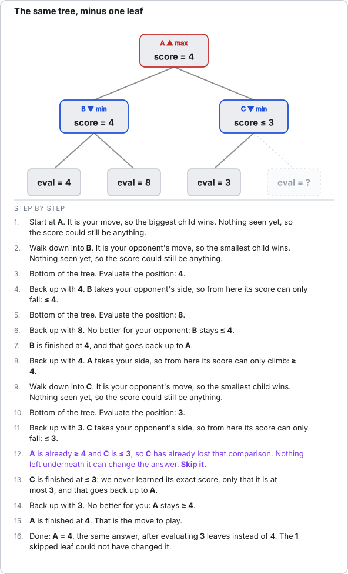
</game-tree>

Step both to the end and compare. Same root, `A = 4`, same move. But the fourth leaf was never
evaluated, and `C` ends up saying `score ≤ 3` where minimax said `score = 2`.

That `≤` is the point. `C` is your opponent's node, so `C` can only go down from here, and `A`
already has `B` in hand at 4. Whatever the last leaf turns out to be, `C` cannot climb back above
`B`, so `A` will never choose it. The exact value of `C` is not wrong, it is simply not needed, and
the search is allowed to stop being curious.

Note what your engine gives up: it now finishes with a *bound* on `C` rather than a value. Ask it
"how good is `C` exactly?" and it cannot tell you. Ask it "which move should I play?" and it is
right every time. That is the trade, and it costs nothing you were using.

## Alpha and beta

Doing this systematically means every node carries two numbers with it on the way down:

- **alpha**, the best score you have already secured somewhere else in the tree
- **beta**, the best your opponent has already secured somewhere else

Together they are a **window**: the range of scores this node could still return that anybody would
care about. If a node discovers it will come back with something outside that window, then some
earlier decision already beats it, and the rest of that node is dead weight. Stop and return.

In negamax form the window flips exactly like the score does: you pass `-beta, -alpha` to the child
and negate what comes back. Here is the same cut with the window drawn in:

<game-tree mode="negamax-alphabeta">
  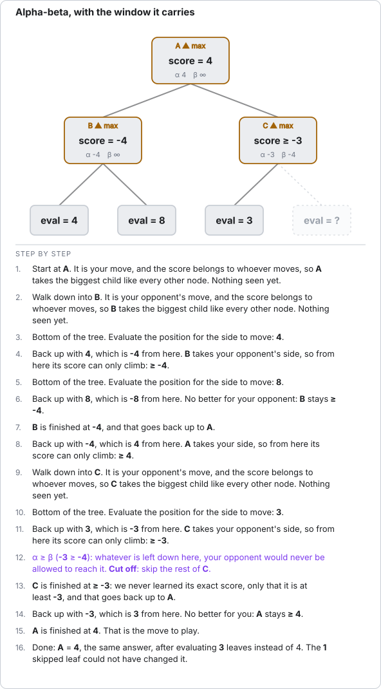
</game-tree>

Watch `C`: it is searched with `α -3 β -4`, and the moment α ≥ β the node stops. That is the same
cut you just read as "C is already worse than B", written in a form that works at any depth,
including cuts caused by a node several levels further up.

Being honest about it: this chapter does not prove the method correct. The proof is genuinely
awkward, and the awkwardness is historical, not personal. Alpha-beta was known to McCarthy in 1956,
who criticised an early chess program at the Dartmouth conference for not doing it, but he never
wrote a specification. Newell, Shaw and Simon published a one sided version in 1958 that never took
the deep cuts. Brudno published the full method in Russia in 1963 with a complicated proof, quite
independently. English descriptions of the complete technique only turn up around 1969. Knuth and
Moore, whose 1975 analysis is the standard reference, put it this way:

> The alpha-beta technique seems to be quite difficult to communicate verbally, or in conventional
> mathematical language, and the authors of the papers cited above had to resort to rather
> complicated descriptions; furthermore, considerable thought seems to be required at first
> exposure to convince oneself that the method is correct, especially when it has been described in
> ordinary language and "deep cutoffs" must be justified. Perhaps this is why many years went by
> before the technique was published.

If you want the proof, it is in that paper: Knuth and Moore, *An Analysis of Alpha-Beta Pruning*,
Artificial Intelligence 6 (1975), 293-326.

Task:

Add `alpha` and `beta` parameters to your `negamax` and rename it `alphabeta`. Inside the move
loop: raise `alpha` whenever you find a better score, and stop the loop entirely once
`alpha >= beta`. Recurse with the window flipped, `-beta, -alpha`.

`choose_move` starts the search with the widest window there is, `-inf` to `+inf`, and can keep its
own `alpha` up to date as it goes, since a move it has already secured is exactly what alpha means.

<details>
<summary>Solution (challenging, can look right away)</summary>

```python
def choose_move(board: chess.Board) -> chess.Move:
    best_move = None
    best_score = -math.inf

    # `alpha` is the best score we have already secured. Every move we try after
    # this one only has to be compared against it.
    alpha = -math.inf

    for move in board.legal_moves:
        board.push(move)
        score = -alphabeta(board, DEPTH - 1, -math.inf, -alpha)
        board.pop()

        if score > best_score:
            best_score = score
            best_move = move
            alpha = score

    if best_move is None:
        raise ValueError("choose_move is called on board without legal moves")

    return best_move


def alphabeta(board: chess.Board, depth: int, alpha: float, beta: float) -> float:
    """Negamax, but stop searching a node once it cannot affect the result."""
    outcome = board.outcome()
    if outcome is not None:
        return 0 if outcome.winner is None else -MATE_SCORE

    if depth == 0:
        return evaluate_relative(board)

    best = -math.inf
    for move in board.legal_moves:
        board.push(move)
        # The window belongs to the side to move too, so it flips and swaps
        # exactly like the score does.
        score = -alphabeta(board, depth - 1, -beta, -alpha)
        board.pop()

        if score > best:
            best = score
        if best > alpha:
            alpha = best
        if alpha >= beta:
            break  # cutoff: the opponent would never allow this position

    return best
```

Full solution: [`solutions/alphabeta.py`](https://github.com/MachinePlay/python-chess-starter/blob/main/solutions/alphabeta.py)

</details>

Now compare the `info` lines at the same depth, in the same position:

```
minimax     info depth 3 nodes 24941 score cp 100 pv h1g1
alphabeta   info depth 3 nodes  1442 score cp 100 pv h1g1
```

Same move, same score, seventeen times less work. Upload it as `alphabeta` and play it against
`minimax` if you like, but expect a mirror: at equal depth these two are the same engine.

## Move ordering

Alpha-beta only ever cuts once it has something good in hand. The first child of a node is always
searched in full, and nothing can be refuted before there is something to refute it with. So the
order you try moves in decides how much of the tree you get to skip.

Here is a three level tree searched with the moves in the worst possible order:

<game-tree mode="alphabeta" tree='{"kind":"max","children":[{"children":[{"children":[{"value":3},{"value":6}]},{"children":[{"value":4},{"value":5}]}]},{"children":[{"children":[{"value":1},{"value":8}]},{"children":[{"value":2},{"value":7}]}]}]}'>
  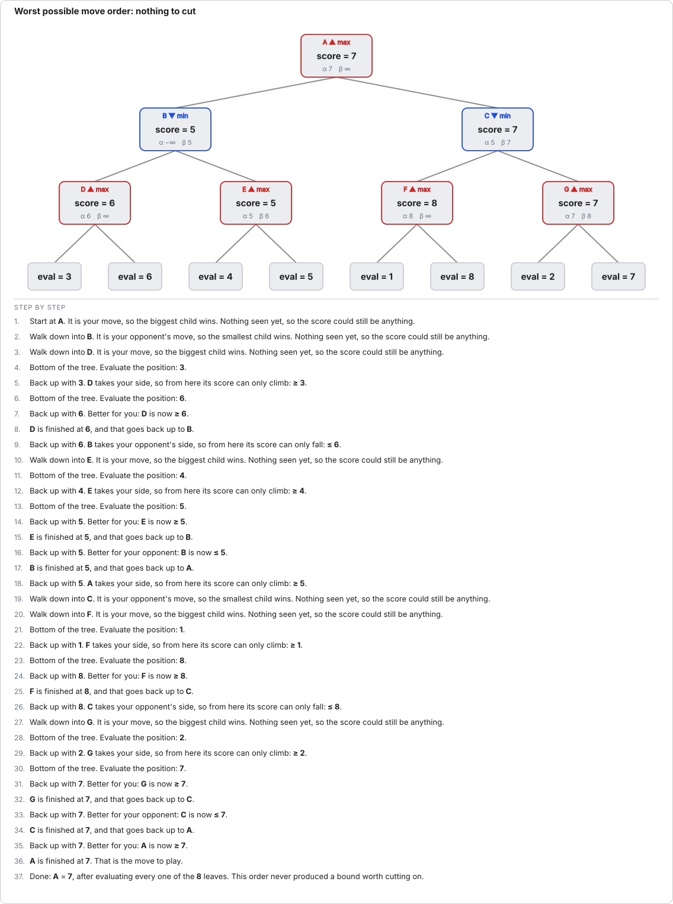
</game-tree>

Eight leaves out of eight, not a single cutoff. Every node kept finding a better child than the one
before, and a node that keeps improving never gets the chance to refuse anything.

Now the same tree, same leaves, same answer, with the best child first everywhere:

<game-tree mode="alphabeta" tree='{"kind":"max","children":[{"children":[{"children":[{"value":7},{"value":2}]},{"children":[{"value":8},{"value":1}]}]},{"children":[{"children":[{"value":5},{"value":4}]},{"children":[{"value":6},{"value":3}]}]}]}'>
  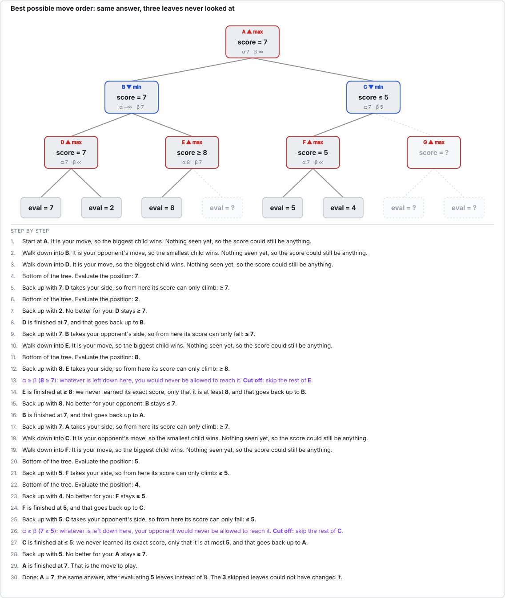
</game-tree>

Five leaves, and `G` was never opened at all. Same root score, same move.

The gap grows fast with depth. Given perfect ordering, alpha-beta looks at roughly the square root
of the tree, `b^(d/2)` positions instead of `b^d`, which is the same as saying it searches twice as
deep for the price minimax paid. Knuth and Moore also prove that you cannot do better: no algorithm
that returns the exact score can examine fewer positions.

Perfect ordering means knowing the best move before you search, which is precisely the thing you
are searching for. But you do not need perfect, you need a cheap guess that is right often enough.

In chess the cheap guess is captures. They are where material swings, so they are where the good
moves and the refutations live. Among captures, prefer the **most valuable victim** taken by the
**least valuable attacker**: taking a queen with a pawn is a much better bet than taking a pawn with
a queen. Engines call this MVV-LVA, and it is one `sorted()` call.

Task:

Sort the moves before you loop over them, in `choose_move` and in `alphabeta` both. Score each move
`10 * victim - attacker`, with 0 for a move that captures nothing, and sort descending. The factor
of 10 makes the victim dominate, so the attacker only breaks ties between moves that take the same
piece, and quiet moves land at the back.

Chess APIs you will need:
- `board.piece_type_at(square)`, the piece type on a square or `None`
- `move.from_square` and `move.to_square`

<details>
<summary>Solution (try it yourself first)</summary>

```python
def order_moves(board: chess.Board, moves: list[chess.Move]) -> list[chess.Move]:
    """Try captures first, grabbing the biggest piece with the smallest one."""

    def score(move: chess.Move) -> int:
        victim = board.piece_type_at(move.to_square)
        if victim is None:
            return 0
        attacker = board.piece_type_at(move.from_square)
        assert attacker is not None
        return 10 * PIECE_TYPE_COST[victim] - PIECE_TYPE_COST[attacker]

    return sorted(moves, key=score, reverse=True)
```

Then loop over `order_moves(board, list(board.legal_moves))` instead of `board.legal_moves`.

</details>

At depth 4 in the position above, that one sort takes the search from 12470 nodes to 4696, and it
plays the same move it played before. Ordering never changes the answer, only how long you wait
for it.

So: alpha-beta at depth 4 with ordering costs a fifth of what plain minimax spent to see one move
less far. Raise `DEPTH` to 4 and play *that* against `minimax`.

Then try 5, and watch a sharp position with a lot of captures take many times longer than a quiet
one. A fixed depth is a promise your engine cannot keep on a clock, which is the next chapter.

# Iterative deepening

`DEPTH = 5` is a promise your engine cannot keep. Here it is in four positions out of the same few
openings:

```
info depth 5 nodes  34356   1.8s     after 1.e4 e5 2.Nf3 Nc6
info depth 5 nodes  83107   4.4s     after 1.e4 e5 2.Nf3 Nc6 3.Bc4 Nf6 4.Ng5 d5 5.exd5 Nxd5
info depth 5 nodes  89678   4.5s     after 1.d4 d5 2.c4 e6 3.Nc3 Nf6 4.Bg5 Be7
info depth 5 nodes 165811   8.1s     after 1.e4 c5 2.Nf3 d6 3.d4 cxd4 4.Nxd4 Nf6 5.Nc3 a6
```

Same engine, same depth, four times the wait, and no way of telling which one you are in until you
have already spent the time. Meanwhile every real game has a clock, and your engine has never once
looked at it: it ignores everything after `go`.

There are two ways that ends. Set `DEPTH` low and you play fast, shallow moves and lose to anything
that thinks. Set it high and sooner or later you sit on one position until your flag falls.

What you want is to think until the time is nearly up and then answer, which is a strange thing to
ask of a recursive search: stop it halfway and it has nothing to say. Depth 5 half finished is not
"a bit worse than depth 5", it is a handful of moves scored and the rest unexamined, and the best of
what it has seen so far can easily be a blunder.

The fix is almost silly. Search depth 1. Then search the whole thing again at depth 2. Then again at
depth 3. After every *completed* pass you hold a legal, fully searched best move, so when the clock
runs out you play the last one you finished. That is iterative deepening.

## Reading the clock

`go` carries the time control, and a GUI sends one of a few shapes:

```
go
go depth 4
go movetime 1000
go wtime 300000 btime 300000 winc 2000 binc 2000
```

`wtime` and `btime` are what is left on each player's clock in milliseconds, `winc` and `binc` are
the increments added after each move. Only your own side's numbers matter.

Turning that into a budget is guesswork, and a rough guess is fine: assume the game has about 20
moves left, spend a twentieth of the clock, and add most of the increment since you get it back.
Never bet more than you actually have.

Task: parse `go` into a number of seconds to think for.

<details>
<summary>Solution (try it yourself first)</summary>

```python
MAX_DEPTH = 64  # we stop here even if there is still time left
DEFAULT_BUDGET = 3.0  # seconds to think when `go` arrives without a clock
SAFETY = 0.95  # never use quite all of the time we are given


def parse_go(command: str, board: chess.Board) -> tuple[float, int]:
    tokens = command.split()

    def value(name: str, default: int = 0) -> int:
        if name in tokens:
            return int(tokens[tokens.index(name) + 1])
        return default

    if "depth" in tokens:
        return math.inf, value("depth")

    if "movetime" in tokens:
        return value("movetime") / 1000 * SAFETY, MAX_DEPTH

    # The clock is given for both players; only ours matters.
    if board.turn == chess.WHITE:
        remaining, increment = value("wtime"), value("winc")
    else:
        remaining, increment = value("btime"), value("binc")

    if remaining == 0:  # a bare `go`, with no clock at all
        return DEFAULT_BUDGET, MAX_DEPTH

    budget = min(remaining / 20 + increment * 0.8, remaining * SAFETY)
    return budget / 1000, MAX_DEPTH
```

And the `go` branch of the UCI loop passes the result on:

```python
        elif command.startswith("go"):
            budget, max_depth = parse_go(command, board)
            move = choose_move(board, budget, max_depth)
            print(f"bestmove {move.uci()}")
```

</details>

## Stopping in the middle

The search has to be able to give up wherever it happens to be. Two things make that awkward.

Reading the clock is not free, and `alphabeta` is called tens of thousands of times a second, so
check it every few hundred nodes instead of every one. And an abandoned search leaves half applied
moves on the board, since the `board.pop()` calls on the way out never happen, so search on a copy
and leave the caller's board alone.

Task: give up on the search once a deadline passes.

<details>
<summary>Solution (try it yourself first)</summary>

An exception is the tidy way out of a deep recursion:

```python
CLOCK_CHECK_INTERVAL = 256  # nodes between two reads of the clock

DEADLINE = math.inf  # time.monotonic() value at which we must stop


class TimeUp(Exception):
    """Raised deep inside the search when the clock runs out."""
```

and at the top of `alphabeta`, right after counting the node:

```python
    if NODES % CLOCK_CHECK_INTERVAL == 0 and time.monotonic() > DEADLINE:
        raise TimeUp
```

</details>

## The loop

Now the outer loop. Search depth 1, 2, 3, and so on, keeping the result of the last pass that
actually finished. Three details are worth having:

- feed the previous winner to the next pass first. Alpha-beta cuts hardest when the best move comes
  first, and the best move at depth 3 is usually still the best at depth 4. Ordering that costs you
  nothing to compute is the most valuable kind
- stop on a forced mate, there is nothing deeper to learn
- do not *start* a pass you cannot finish. The next depth costs several times the current one, so
  if half the budget is already gone, stop here

Task: turn `choose_move` into that loop.

<details>
<summary>Solution (try it yourself first)</summary>

```python
def choose_move(board: chess.Board, budget: float, max_depth: int) -> chess.Move:
    global NODES, DEADLINE

    NODES = 0
    start = time.monotonic()
    DEADLINE = start + budget

    # An abandoned search leaves half-played moves behind, so work on a copy.
    board = board.copy()

    moves = order_moves(board, list(board.legal_moves))
    if not moves:
        raise ValueError("choose_move is called on board without legal moves")

    best_move = moves[0]  # so we always have something legal to play

    for depth in range(1, max_depth + 1):
        try:
            move, score = search_root(board, depth, moves)
        except TimeUp:
            break  # this depth never finished, so keep the last complete answer

        best_move = move

        # Try the winner first next time round.
        moves.remove(move)
        moves.insert(0, move)

        elapsed = time.monotonic() - start
        print(
            f"info depth {depth} nodes {NODES} time {int(elapsed * 1000)} "
            f"score cp {int(score)} pv {move.uci()}"
        )

        if abs(score) >= MATE_SCORE - max_depth:
            break  # a forced mate; nothing deeper left to learn

        if elapsed > budget * 0.5:
            break

    return best_move
```

`search_root` is the root loop you already had in the alpha-beta chapter, with the move list handed
in from outside so the ordering survives between passes:

```python
def search_root(
    board: chess.Board, depth: int, moves: list[chess.Move]
) -> tuple[chess.Move, float]:
    """One complete iteration: the best move at exactly `depth`."""
    best_move = moves[0]
    best_score = -math.inf
    alpha = -math.inf

    for move in moves:
        board.push(move)
        score = -alphabeta(board, depth - 1, -math.inf, -alpha)
        board.pop()

        if score > best_score:
            best_score = score
            best_move = move
            alpha = score

    return best_move, best_score
```

Full solution: [`solutions/iterative_deepening.py`](https://github.com/MachinePlay/python-chess-starter/blob/main/solutions/iterative_deepening.py)

</details>

Ask it for a second of thought and watch it climb:

```
position startpos moves e2e4 e7e5 g1f3 b8c6
go movetime 1000
info depth 1 nodes 27 time 1 score cp 100 pv f3e5
info depth 2 nodes 142 time 7 score cp 0 pv f3g1
info depth 3 nodes 1188 time 59 score cp 100 pv h1g1
info depth 4 nodes 6229 time 318 score cp 0 pv f1b5
bestmove f1b5
```

Depth 1 grabs the pawn, depth 2 sees it taken back, and it settles down from there. It started
depth 5 as well, ran out of time somewhere inside it, and threw that pass away.

## Searching the same tree five times

The obvious objection: depths 1 to 4 were all thrown away, so that is four wasted searches.

Measure it. Alpha-beta straight to depth 5, against iterative deepening climbing all the way to
depth 5, same position:

```
fixed depth 5        info depth 5 nodes 34356          1.82s
1, 2, 3, 4, 5        info depth 5 nodes 35137          1.83s
```

Two percent. Every depth costs several times the one below it, so the sum of everything before the
last pass is a rounding error against the last pass alone. That is the geometry of the branching
factor working for you for once.

And the two percent is not even a loss, because feeding each pass the previous winner improves the
ordering enough to pay for itself. What you buy with it is an engine that answers whenever it is
asked, at whatever depth the position and the clock allowed, instead of a fixed number that is
either too slow or too dumb.

Upload it as `iterative` and play it against `alphabeta` at a real time control. Same search, same
evaluation, and it wins because it is never the one who ran out of time.

# Quiescence

Look at the scores your engine printed when you asked it for a second of thought in the last
chapter:

```
info depth 1 nodes 27 time 1 score cp 100 pv f3e5
info depth 2 nodes 142 time 7 score cp 0 pv f3g1
info depth 3 nodes 1188 time 59 score cp 100 pv h1g1
info depth 4 nodes 6229 time 318 score cp 0 pv f1b5
```

100, 0, 100, 0. A pawn up at every odd depth, dead level at every even one, and the engine changes
its mind about the same position with every extra move of search.

That is the horizon problem from the minimax chapter, caught on camera. An odd depth ends on your
own move, so the last thing the search sees is its own capture, with the recapture one move past
the horizon. An even depth ends on the opponent's move and sees the recapture just fine. `evaluate`
is being asked about positions in the middle of an exchange, and it counts pieces that are about to
disappear as if they were staying.

The fix follows from saying the problem out loud: stop evaluating positions in the middle of a
fight. When the search runs out of depth in a position that is still loud, keep searching, but only
the captures, until it goes quiet, and evaluate there. Quiet is what the name means: this tail of
the search is called **quiescence search**.

Captures-only is what keeps it affordable. Every capture removes a piece from the board, so a chain
of captures burns itself out in a handful of moves, and most positions offer two or three captures
next to thirty moves.

## Standing pat

One extra idea makes it sound. In the quiescence tail, the side to move has an option minimax never
models: stop capturing. If every capture on the board loses material, you would just play a quiet
move instead, and quiet moves are exactly what this search no longer looks at. So take the
evaluation of the position as it stands as a floor on the score, the "I can always decline" score.
Engines call that **standing pat**, borrowed from poker, and it slots straight into the alpha-beta
machinery you already have: evaluate first, treat that score like a move you already searched,
raise alpha with it, cut off with it, and only then start on the captures.

The small print: "I can always play something quiet instead" is a bet, not a rule. Chess makes you
move, and there are positions where every move makes things worse. That is called zugzwang, and one
is waiting for you in the last chapter of this tutorial. The bet is wrong rarely enough that every
real engine takes it anyway.

Task:

Write `quiescence(board, alpha, beta)`. It is `alphabeta` with the depth gone: count the node and
check the clock the same way, return the same scores when the game is over, then stand pat, then
loop over the captures only, same window, same cutoff. Make `alphabeta` call it at `depth == 0`
where `evaluate_relative` used to be.

Chess APIs you will need:
- `board.generate_legal_captures()`, the legal moves that capture something, and nothing else

<details>
<summary>Solution (try it yourself first)</summary>

```python
def quiescence(board: chess.Board, alpha: float, beta: float) -> float:
    """Search captures only until the position goes quiet, then evaluate."""
    global NODES
    NODES += 1

    if NODES % CLOCK_CHECK_INTERVAL == 0 and time.monotonic() > DEADLINE:
        raise TimeUp

    outcome = board.outcome()
    if outcome is not None:
        return 0 if outcome.winner is None else -MATE_SCORE

    # Standing pat: the side to move is never forced to keep capturing, so the
    # position as it stands is a floor on its score.
    best = evaluate_relative(board)
    if best > alpha:
        alpha = best
    if alpha >= beta:
        return best

    for move in order_moves(board, list(board.generate_legal_captures())):
        board.push(move)
        score = -quiescence(board, -beta, -alpha)
        board.pop()

        if score > best:
            best = score
        if best > alpha:
            alpha = best
        if alpha >= beta:
            break

    return best
```

and in `alphabeta`:

```python
    if depth == 0:
        return quiescence(board, alpha, beta)
```

The `order_moves` sort from the alpha-beta chapter is doing double duty here: in a search made of
nothing but captures, "biggest victim, smallest attacker" is nearly the whole ordering story.

Full solution: [`solutions/quiescence.py`](https://github.com/MachinePlay/python-chess-starter/blob/main/solutions/quiescence.py)

</details>

Same position, same second of thinking:

```
info depth 1 nodes 58 time 2 score cp 0 pv f3g1
info depth 2 nodes 267 time 13 score cp 0 pv f3g1
info depth 3 nodes 2143 time 76 score cp 0 pv f3g1
info depth 4 nodes 9751 time 460 score cp 0 pv f3g1
```

The oscillation is gone. Depth 1 used to grab the e5 pawn and celebrate; now the moment it
considers `f3e5`, the quiescence tail plays out the recapture and scores the grab at -200, which is
what it was all along. Every depth agrees the position is level, because it is.

The honesty is not free: the tail hangs off nearly every leaf, and each depth now costs half again
to twice what it did. What it buys is an engine that no longer walks into any exchange that looks
good for exactly one move, and a score you can finally trust. The rest of this tutorial quietly
leans on that: every evaluation idea from here on gets judged through this search, and judging
with an instrument that lies at every loud position would tell you nothing.

Upload it as `quiescence` and put it against `iterative`, and expect draws more than fireworks.
Fixing the horizon mostly fixed the *losing*: to actually win a game an engine needs a reason to
unbalance a position, and a material count gives it none. Look at the move it keeps choosing up
there: `f3g1`, retreating a developed knight. The position really is level, so to a material
counter, undeveloping a piece is exactly as good as anything else that hangs nothing. Your
evaluation has no opinion about where pieces belong, which is the next chapter, and where the
wins come back.

# Piece square tables

The search is finished. From here to the end of the ladder, everything is `evaluate`, which so far
knows exactly one thing: how much wood is on the board.

A knight on h1 attacks two squares, a knight on e4 attacks eight. Same knight, same 300 centipawns,
completely different piece. The standard fix is a table of 64 numbers per piece type, added to that
piece's value depending on where it stands.

Here is the classic knight table. Green is where a knight wants to be:

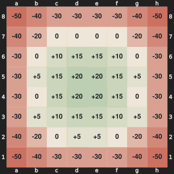

The tables are written from white's point of view, so black reads the same table upside down: what
is a8 for white is a1 for black. `chess.square_mirror` does that flip.

Task: give every piece type a table and add the value of its square to its material value.

Chess APIs you will need:
- `board.piece_map()`, every occupied square and its piece, in one dict
- `chess.square_mirror(square)`, the same square seen from the other side

<details>
<summary>Solution (try it yourself first)</summary>

```python
KNIGHT_PST = [
    -50, -40, -30, -30, -30, -30, -40, -50,
    ...
]  # 64 numbers, a1 first

PST_BY_PIECE_TYPE = {chess.PAWN: PAWN_PST, chess.KNIGHT: KNIGHT_PST, ...}


def evaluate(board: chess.Board) -> int:
    score = 0

    for square, piece in board.piece_map().items():
        seen_from = square if piece.color == chess.WHITE else chess.square_mirror(square)
        value = PIECE_TYPE_COST[piece.piece_type] + PST_BY_PIECE_TYPE[piece.piece_type][seen_from]
        score += value if piece.color == chess.WHITE else -value

    return score
```

[`solutions/pst.py`](https://github.com/MachinePlay/python-chess-starter/blob/main/solutions/pst.py) has tables for all six piece types, and writes them rank 8 first so you can
read them as a board.

</details>

Ask it about the starting position:

```
position startpos
go movetime 1000
info depth 1 nodes 40 time 2 score cp 50 pv g1f3
info depth 2 nodes 152 time 8 score cp 0 pv g1f3
info depth 3 nodes 1529 time 79 score cp 50 pv g1f3
info depth 4 nodes 6250 time 370 score cp 0 pv g1f3
bestmove g1f3
```

Knight toward the centre, not away from it. (A small flip-flop is back in the scores, but this one
is not the horizon: whoever just moved really is a tempo ahead in development now, and the tables
can see it. Nothing is being miscounted.)

## The king changes its mind

One piece cannot have a single table, and that is the king. While the queens are on it wants to be
behind its own pawns in a corner:

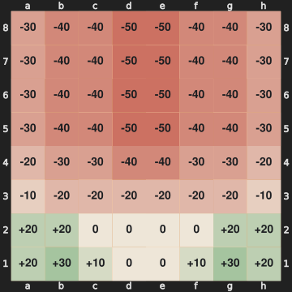

Once the board empties out, the same king is a strong piece that should walk to the middle and help:

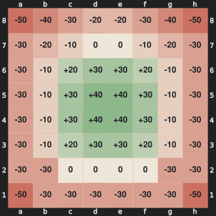

Those two tables are near enough opposites, which means an engine with only the first one shuffles
its king in the corner in a king and pawn endgame and never wins it, and an engine with only the
second one walks its king into the middle on move 12 and gets mated.

So you need to know which one you are in. There is no exact definition of "endgame", and a cheap
approximation is fine: add up everything that is not a king or a pawn, and call it an endgame once
that total drops below roughly a queen and a rook per side.

Task: pick the king table by that test.

<details>
<summary>Solution (try it yourself first)</summary>

```python
ENDGAME_MATERIAL = 2600  # non-pawn material left on the board, both sides


def is_endgame(board: chess.Board) -> bool:
    heavy = sum(
        PIECE_TYPE_COST[piece.piece_type]
        for piece in board.piece_map().values()
        if piece.piece_type not in (chess.KING, chess.PAWN)
    )
    return heavy <= ENDGAME_MATERIAL
```

and in `evaluate`, where the piece is a king:

```python
        if piece.piece_type == chess.KING:
            place = (KING_ENDGAME_PST if endgame else KING_MIDDLEGAME_PST)[seen_from]
        else:
            place = PST_BY_PIECE_TYPE[piece.piece_type][seen_from]
```

</details>

The threshold is a cliff: cross it and every king square changes value by up to 90 centipawns at
once, which can make the engine play a move purely to stay on one side of the line. Real engines
blend the two tables smoothly instead, weighted by how much material is left. That is a good first
thing to try yourself.

Upload it as `pst` and put it against `quiescence`. This is the biggest jump of strength on the
whole ladder, and the one rung you can check with your bare eyes: it brings its pieces out, it
fights for the centre, and its games start looking like chess played on purpose. The last chapter
taught the search not to lie about a position; this one finally gave the engine a reason to prefer
one level position over another, and that is where wins come from.

# Did it help?

Fair warning: this is the chapter where certainty ends. Search changes were provable, alpha-beta
returns the same move and you can check the node count. Evaluation changes are guesses. A number
that sounds obviously right can easily make your engine worse, and you cannot tell by watching one
game. Piece square tables were the safe kind of guess, polished by a century of book chess. This
chapter takes a normal one: an idea that sounds every bit as right, followed by the part everybody
skips, finding out whether it helped.

## Mobility

A position where you have plenty of moves and your opponent has almost none is usually good for
you, whoever is up material. Here is the extreme version:

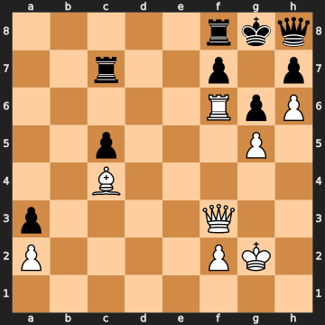

White to play, and the material half of your `evaluate` scores this at -300: black has two rooks
where white has a rook and a bishop, and a spare pawn on top. By that measure, black is winning.

Black is lost. Not one black piece can do anything: white has 42 legal moves here and black has 13,
which are six shuffles of the c7 rook, five of the f8 rook, and two queen moves that drop the queen.
Black's pawns cannot move at all. This is AlphaZero against Stockfish 8, 2017, the game
people call the Immortal Zugzwang, and material is exactly the wrong thing to be counting in it.
(It is also the small print from the quiescence chapter made real: standing pat bets that doing
nothing is always an option, and zugzwang is the name for the positions where it is not.)

You are not going to teach your engine that in one afternoon, but you can teach it the direction:
count your moves, count theirs, take the difference.

The awkward part is counting your opponent's moves without playing anything, and python-chess has
exactly the tool: a **null move**, which passes the turn.

Task: add mobility to `evaluate`, from white's point of view, worth a few centipawns per move.

Chess APIs you will need:
- `board.legal_moves.count()`
- `board.push(chess.Move.null())`, pass the turn, undone with `board.pop()` as usual. It is illegal
  while in check, so skip mobility there

<details>
<summary>Solution (try it yourself first)</summary>

```python
MOBILITY_WEIGHT = 3  # centipawns per extra legal move


def mobility(board: chess.Board) -> int:
    """Legal moves for white minus legal moves for black."""
    if board.is_check():
        return 0

    ours = board.legal_moves.count()
    board.push(chess.Move.null())
    theirs = board.legal_moves.count()
    board.pop()

    return ours - theirs if board.turn == chess.WHITE else theirs - ours
```

and at the end of `evaluate`:

```python
    return score + MOBILITY_WEIGHT * mobility(board)
```

Full solution: [`solutions/mobility.py`](https://github.com/MachinePlay/python-chess-starter/blob/main/solutions/mobility.py)

</details>

In the position above that is worth `3 * (42 - 13) = 87` centipawns to white, which does not come
close to overturning a piece, and should not. Mobility is a nudge, not a verdict: it breaks ties
between moves that the rest of the evaluation thinks are identical.

Note what this costs. `evaluate` runs at every leaf, which is nearly every node, and mobility
generates all the legal moves twice more each time. That is not a small tax, and it comes straight
out of your depth: given the same second on the starting position, `pst` finishes depth 4 and
`mobility` gets thrown out of it halfway through. More knowledge per position, fewer positions.
Whether that trade is a win is not something you can reason your way to.

## Play forty games

Measure it, then. Upload it as `mobility`, put it against `pst`, and watch the game tell you
nothing. You have known one game is noise since the random mover chapter, and this change is far
smaller than that one was.

So play forty, locally, with `fastchess`, the same match runner machineplay uses on the inside
(the appendix has more on it). 0.3 seconds a move:

```sh
fastchess \
  -engine cmd=uv args="run python solutions/mobility.py" name=mobility \
  -engine cmd=uv args="run python solutions/pst.py" name=pst \
  -each st=0.3 -rounds 20 -games 2 -concurrency 4
```

```
Games: 40, Wins: 0, Losses: 0, Draws: 40
Elo: -0.00 +/- 0.00, DrawRatio: 100.00 %
```

Forty draws out of forty. That is not saying the engines are equal, it is saying the experiment is
broken. Both engines are deterministic, same position in, same move out, and every game started
from the same position. Save the games (add `-pgnout file=games.pgn`) and look: there are exactly
two games in there, one per colour assignment, replayed twenty times each. A suspiciously clean
number is a bug report about your setup, in chess or anywhere else.

The fix is standard practice: give every game pair a different opening, so the engines start their
thinking from forty different positions instead of one. The starter repo ships `openings.epd`,
twenty well-trodden openings a few moves deep, and fastchess deals them out with
`-openings file=openings.epd format=epd order=random`.

One problem: hand your engine an opening and it dies on the spot, on the `ValueError` that has been
sitting in `parse_position` since the starter chapter. An opening arrives as `position fen ...`,
the second form of the command, and your engine only reads the first.

Task: teach `parse_position` the fen form. Everything after the word `fen` and before the word
`moves` is the position, and `chess.Board(...)` accepts it whole.

<details>
<summary>Solution (try it yourself first)</summary>

```python
def parse_position(command: str) -> chess.Board:
    """Build a board from a UCI ``position`` command.

    Handles the two forms the protocol allows:

        position startpos moves e2e4 e7e5
        position fen r1bqkbnr/pppp1ppp/2n5/1B2p3/4P3/5N2/PPPP1PPP/RNBQK2R b KQkq - 0 1
    """
    tokens = command.split()
    moves_index = tokens.index("moves") if "moves" in tokens else len(tokens)

    if tokens[1] == "startpos":
        board = chess.Board()
    else:  # everything between `fen` and `moves` is the position itself
        board = chess.Board(" ".join(tokens[2:moves_index]))

    for uci in tokens[moves_index + 1 :]:
        board.push_uci(uci)

    return board
```

Both sides of a match need it, so `solutions/pst.py` carries the same change. It is also what makes
your engine work with desktop GUIs and their opening books, see the appendix.

</details>

Openings in, forty fresh games:

```
Games: 40, Wins: 2, Losses: 8, Draws: 30
Elo: -52.51 +/- 50.24, DrawRatio: 50.00 %
```

Mobility lost the match. Not a landslide, two wins against eight with thirty draws, but the one
outcome the data refuses to support is the one the idea promised: better. The zugzwang position
was real, the reasoning was fine, and at a third of a second per move the extra knowledge still
was not worth the depth it cost. If it stings to rip out a feature that sounded this sensible,
good, that sting is the chapter: in evaluation, *plausible* and *helpful* are different claims,
and only the first one can be settled by argument.

Even this verdict is blurry: the error bar runs from "much worse" to "roughly level". Chess engine
changes are usually worth tens of Elo, and tens of Elo need thousands of games to see through the
draws. That is why serious engine projects keep a testing framework running matches until the
result is statistically settled, throwing out every change that fails. The technique is called
SPRT, and it stops a match as soon as the evidence is one-sided enough, in either direction.

> [!TODO]
> machineplay does not run SPRT yet. Tournaments play a fixed number of games.

So upload each idea as its own version and let them play a real match instead of trusting the last
game you watched. machineplay does the forty-games part for you: open
[tournaments](https://machineplay.org/tournament), start a new one, add `<your-engine>:mobility` and
`<your-engine>:pst` as players, pick how many games each pairing plays, a time control, an opening
book and a runner, and the tournament page fills in the standings as the games finish. It deals
openings from the book the same way `-openings` did above, so you do not need the `fen` fix to
play there, although you do need it locally.

As for mobility, it comes back out of
`evaluate`, or goes back on the bench for a rework: a smaller weight, a cheaper approximation,
counting only moves toward the centre. The measurement does not tell you which, it only promises
an honest answer about the next attempt. Reverting a reasonable idea because the numbers said so
is not a defeat; it is the method that built every engine you have ever lost to.

# What to do next

You have a real chess engine: it speaks UCI, it searches with alpha-beta, it knows better than to
evaluate mid-capture, it manages a clock, and it will beat most people who play a few games a year.
Here is where the road forks.

**The one thing to do first.** A transposition table. Different move orders keep arriving at the
same position, and your search does the full work every single time it gets there. A hash table
keyed on the position remembers the score from last time, and better, the best move from last time,
so every node can try its previous best first, the way the iterative deepening chapter already does
at the root. That ordering is what makes deep searches affordable, and it is the biggest thing your
search is still missing.

**More search.** Killer and history heuristics for better move ordering, late move reductions,
aspiration windows, and a quiescence search that grows up: looking at checks too, and skipping
captures that cannot possibly matter (delta pruning). The
[Chess Programming Wiki](https://www.chessprogramming.org/Main_Page) documents all of it, and it is
where every engine author eventually lives.

**More evaluation.** Pawn structure, king safety, rooks on open files, bishop pairs. Or skip
handwriting it altogether and let a small neural network score positions for you, which is what
every top engine now does.

**More speed.** Python is a beautiful language for learning this and a terrible one for running it.
The same algorithms in a compiled language buy you two or three whole levels of depth for free.
Rewriting your engine in Rust, C++, Go or Zig is the natural next project, and machineplay does not
care which one you pick.

**Less library.** Write the board yourself. `python-chess` has been doing move generation for you
this entire time, and doing it with bitboards, one 64-bit integer per piece type. Implementing that
from scratch is the other half of chess programming, and it is a genuinely satisfying thing to
build.

**More opponents.** Give your engine a proper description on its machineplay page, then go
looking for a fight: put it in tournaments against other people's engines. Star the
[starter template](https://github.com/MachinePlay/python-chess-starter) so the next person finds
it, and send this tutorial to somebody who would enjoy it.

And write things down. The single best way to find out whether you actually understood alpha-beta
is to try explaining it to somebody else, which is roughly why this tutorial exists.

# Appendix: UCI is universal

The U in UCI stands for **Universal**, and it is not decoration. Your `main.py` speaks the same
protocol Stockfish speaks, so anything that can drive a chess engine can drive yours, no docker and
no account anywhere.

**Desktop GUIs**, if you want to sit down and play against your own engine on a board:
[Cute Chess](https://cutechess.com/), [Arena](http://www.playwitharena.de/),
[Banksia GUI](https://banksiagui.com/), [Nibbler](https://github.com/rooklift/nibbler). Point them
at a command that starts your engine and they take it from there. One catch: the moment a game
starts anywhere but the initial position, an opening book, a puzzle, a resumed game, they send
`position fen ...`, so your engine needs the extension from the last chapter to survive out here.

**Match runners**, for playing hundreds of games without watching any of them:
[fastchess](https://github.com/Disservin/fastchess) and
[cutechess-cli](https://github.com/cutechess/cutechess). Both take two engines and a time control
and hand you a result with an error bar:

```sh
fastchess \
  -engine cmd=uv args="run python solutions/mobility.py" name=mobility \
  -engine cmd=uv args="run python solutions/pst.py" name=pst \
  -each st=0.3 -rounds 20 -games 2 -concurrency 4 \
  -openings file=openings.epd format=epd order=random
```

That is exactly the command the last chapter's forty games came from, and fastchess is what
machineplay itself runs behind the scenes.

**Stockfish**, when you want to know how bad your engine really is. It is packaged for every
operating system, it speaks UCI, and it will beat your engine while giving it a queen. Setting
`UCI_LimitStrength` and `UCI_Elo` gives you an opponent you can actually measure yourself against.

So machineplay is a convenience: it packages the annoying parts, the games are live and shareable,
and other people's engines are already there waiting. It is open source, and if it is ever gone, or
just busy, nothing you built here goes with it. The engine is yours and the protocol is everybody's.
